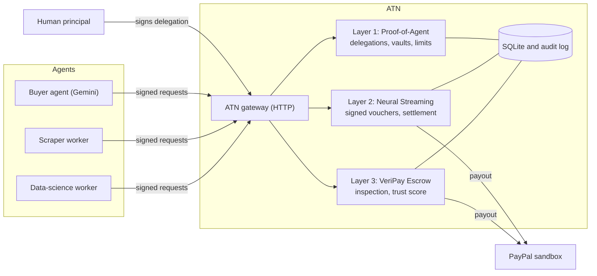
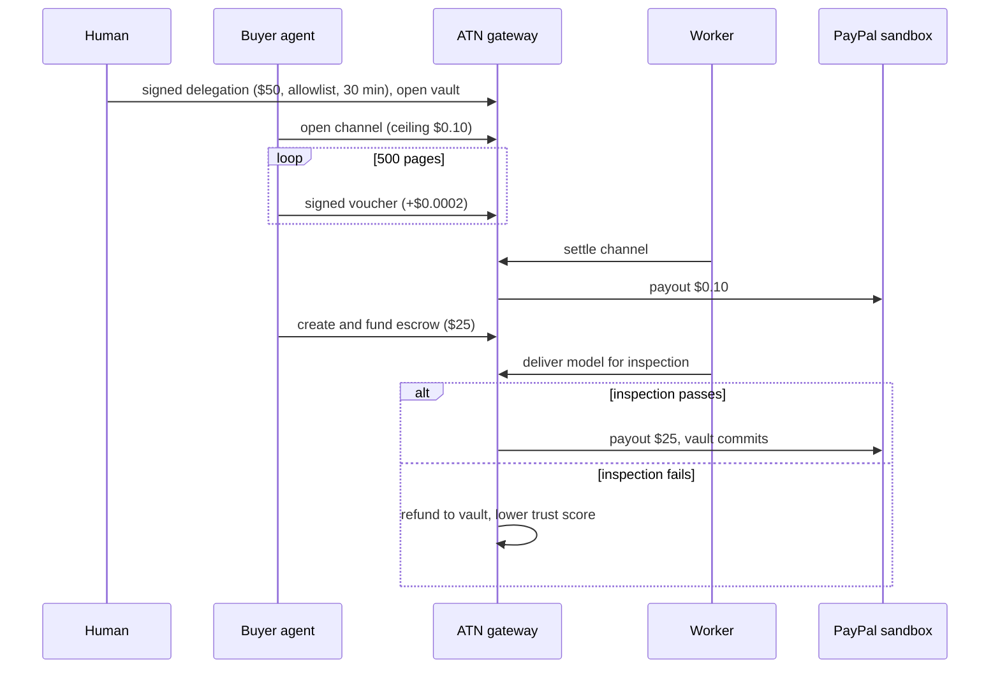

# ATN: Autonomous Trust Network

**Spending limits, fast payments, and proof of delivery for AI agents. Settles over PayPal.**

ATN is one platform made of three systems. Each answers one question about letting AI agents move money, and they are built to work together.

| Layer | Question | What it does |
| --- | --- | --- |
| **1. Proof-of-Agent** | How do we know this agent may spend, and how much? | A human signs a delegation: a ceiling, an allowlist of counterparties, an expiry and an optional minimum trust level. The server opens a vault from it. Spending stops the moment the human revokes. |
| **2. Neural Streaming** | How do agents pay for tiny, fast things? | The agent signs micro-vouchers (200 micro-dollars per page). Nothing touches PayPal until the session closes, then one settlement pays the total. |
| **3. VeriPay Escrow** | How do we know what we paid for is any good? | A $25 escrow is locked in the vault, the delivered model is inspected, and the money is released on a pass or refunded on a fail. A fail lowers the worker's trust score, and layer 1 can refuse low-trust workers. |

The layers share one vault. The vault from layer 1 funds layers 2 and 3, and the trust score from layer 3 feeds back into layer 1.

## Why this exists

Fraud systems look for human signals: typing cadence, mouse movement, device and session history. An AI agent has none of them, so a stolen or hijacked agent can look exactly like a legitimate one. ATN replaces human signals with hard, server-enforced limits that a hijacked agent cannot talk its way past: a signed ceiling, an allowlist, an expiry, a kill switch, and payment only for verified delivery.

## Architecture



### One full lifecycle



### How the pieces are enforced

- **Identity.** Every state-changing request carries a signed envelope (method, path, body hash, nonce, timestamp). The server verifies it against the key registered for that agent or principal. Unsigned, replayed, skewed or wrong-key requests are rejected.
- **Authority.** A delegation is a token signed by the human's key. The server checks the signature, the ceiling, the allowlist, the expiry, and the minimum trust level, all of which are covered by the signature.
- **Hidden funding.** The vault stores only a hash commitment of the human's funding reference. No card or wallet credential is ever accepted, stored or logged.
- **Money.** All amounts are integer micro-dollars (1 USD = 1,000,000). A vault can never have `reserved + committed > funded`, enforced in the database as well as in code.
- **Audit.** Every state change writes an audit event, and secrets are filtered out of audit payloads.

## Quick start

Requires Node 22 or 24 (22.9 or newer). No external services needed.

```
git clone https://github.com/dominionochai/paypal-atn
cd paypal-atn/atn
npm ci
npm test                          # 300+ automated tests
node scripts/demo.mjs             # full lifecycle against a local server, about 3 seconds
npm run scenario -- all           # five agent scenarios, offline, deterministic
```

`demo.mjs` starts its own server on a free port and exits non-zero if any step fails. It runs entirely in simulated settlement and needs no credentials.

### Optional: real PayPal sandbox

Copy `atn/.env.example` to `atn/.env` and fill in your sandbox app's `PAYPAL_CLIENT_ID`, `PAYPAL_CLIENT_SECRET` and a sandbox personal account email as `PAYPAL_PAYEE_EMAIL`. Then:

```
npm run paypal:smoke              # pauses twice for a sandbox buyer to approve an order in a browser
```

The run covers: create order, buyer approval, authorize, capture, refund, a second order authorized and voided, and a payout. A recorded run with the resulting sandbox IDs is in [`atn/docs/PAYPAL_SANDBOX_PROOF.md`](atn/docs/PAYPAL_SANDBOX_PROOF.md). Setting `SETTLEMENT_MODE=PAYPAL_SANDBOX` makes the server use real Payouts for channel settlement and escrow release.

### Optional: live Gemini agent

Set `GEMINI_API_KEY` and `GEMINI_MODEL` (an exact model id from Google AI Studio) in `atn/.env`, then:

```
npm run scenario -- prompt-injection --live
```

## How AI is used

A Gemini model acts as the **buyer agent**. It decides which worker to hire, how large a channel to open, how many pages to buy, whether to commission a model, and how to react when the server refuses something. It acts only through a fixed set of tools (`list_workers`, `open_channel`, `stream_pages`, `settle_channel`, `create_escrow`, `request_inspection`, `get_vault_balance`, `get_trust`). Every tool call goes through the same signed HTTP API as any other client, and the model never sees a private key. The server, not the model, is the authority.

Five scenarios exercise this (`npm run scenario -- <name>`):

| Scenario | What it shows |
| --- | --- |
| `happy-path` | 500 pages settle exactly $0.10, then a $25 escrow passes inspection and is released. Vault committed 25,100,000, available 24,900,000, worker trust 510. |
| `bad-model` | The delivered model fails inspection: refunded, worker trust 450. |
| `prompt-injection` | A scraped page tells the agent to pay an unlisted agent. The server rejects the payment, by channel and by escrow, and an oversized channel. |
| `revoked-mid-stream` | The human revokes mid-stream and the next vouchers are rejected. |
| `trust-gate` | After a failed delivery the worker's trust is below the delegation minimum, so a second escrow is refused. |

Each run records a transcript to `atn/out/<scenario>.json`. Invariants (the vault is never over-committed, nothing is ever paid to an unlisted agent, no channel overspends) are checked for any model. Exact balances are asserted for the deterministic mock model and shown as informational for a live model, because a real model may choose differently.

## How PayPal is used

| PayPal API | Used for |
| --- | --- |
| OAuth 2.0 token | Authenticating every call |
| Orders v2: create (intent AUTHORIZE) and authorize | Placing and confirming a hold on the buyer |
| Payments v2: capture, void, refund | Completing, cancelling or reversing a hold |
| Payouts v1 | Paying workers: channel settlement and escrow release |

All calls use the sandbox and an idempotency key (`PayPal-Request-Id`), and any base URL other than the sandbox is refused. Amounts must be whole cents, so sub-cent vouchers are batched into one settlement before any PayPal call.

## What is real and what is simulated

| Piece | Status |
| --- | --- |
| Signed delegations, vaults, limits, revocation, voucher signing, settlement accounting | Real and covered by automated tests |
| PayPal calls | Real against the PayPal sandbox via `npm run paypal:smoke`. The server defaults to simulated settlement; with `SETTLEMENT_MODE=PAYPAL_SANDBOX` it makes real Payouts calls |
| Escrow hold in server mode | A ledger hold in ATN's own database, because a PayPal order needs a human buyer to approve it in a browser. The real Orders flow is exercised by the smoke script |
| Gemini agent | Real with `--live`. The default mock model is a script, so it demonstrates the server's controls, not that a language model resists prompt injection |
| Model inspector | Structural only (see below) |

## Evidence for each claim

| Claim | Where it is tested |
| --- | --- |
| Unsigned, replayed, skewed and wrong-key requests are rejected | `atn/test/r2c-http.test.ts` |
| Two concurrent $30 holds on a $50 vault: exactly one succeeds | `atn/test/reserve-atomic.test.ts` |
| 500 vouchers settle exactly $0.10 and the unspent reservation is released | `atn/test/streaming.test.ts` |
| Concurrent settles with different keys make exactly one charge | `atn/test/streaming.test.ts` |
| Revoked or expired vaults stop spending | `atn/test/r2c-http.test.ts`, scenario `revoked-mid-stream` |
| Escrow pass releases and fail refunds with a trust change | `atn/test/escrow.test.ts`, scenarios `happy-path` and `bad-model` |
| A signed delegation cannot be edited, including its minimum trust level | `atn/test/agents.test.ts` |
| The Gemini client sends the right requests and keeps signatures | `atn/test/agents.test.ts` (stubbed network) |
| PayPal calls and refusal of non-sandbox URLs | `atn/test/payments.test.ts`, `atn/test/h1-fixes.test.ts`, and the recorded run in `atn/docs/PAYPAL_SANDBOX_PROOF.md` |

## Model inspector

The inspector does **not** run the delivered model and is **not** a sandbox. It checks, offline and in-process: a size limit, an optional SHA-256 match, an allowed media type, well-formed ONNX metadata, and a deny-list of dangerous markers such as Python function operators. A pass means "structurally valid and nothing on the deny-list", nothing more. Details are in [`atn/README.ESCROW.md`](atn/README.ESCROW.md).

## Known limits

- One process and one SQLite database; there is no multi-node locking.
- The default request rate limit is 120 per minute per client. Real 100 ms streaming exceeds that, so raise `RATE_LIMIT_MAX` for it. The scenarios raise it themselves.
- Vouchers are submitted over HTTP. A WebSocket transport module exists and is tested, but it is not wired into the gateway.
- Registration of principals and agents is protected by a single admin token (`ATN_ADMIN_TOKEN`) and must be set; with it unset, registration is refused.
- The signed delegation is an Ed25519 signature over canonical JSON. It is not a zero-knowledge proof.
- PayPal sandbox only. There is no live-payment mode.
- A single Gemini run at temperature 0 is an illustration of model behavior, not a security proof.

## Repository map

| Path | Contents |
| --- | --- |
| `atn/src/trust` | Delegations, vaults, authority checks, signing |
| `atn/src/streaming` | Vouchers, channels, settlement |
| `atn/src/escrow` | Escrow state machine and inspector |
| `atn/src/payments` | PayPal sandbox and simulated adapters, idempotency, reconciliation |
| `atn/src/http` | The HTTP gateway |
| `atn/src/agents` | The Gemini agent, tools, scenarios |
| `atn/test` | Automated tests |
| `atn/scripts` | `demo.mjs` and `paypal-smoke.mjs` |

More detail: [`DEMO.md`](DEMO.md), [`atn/README.API.md`](atn/README.API.md), [`atn/README.AGENTS.md`](atn/README.AGENTS.md), [`atn/README.STREAMING.md`](atn/README.STREAMING.md), [`atn/README.PAYMENTS.md`](atn/README.PAYMENTS.md).

## License

MIT. See [`LICENSE`](LICENSE).
